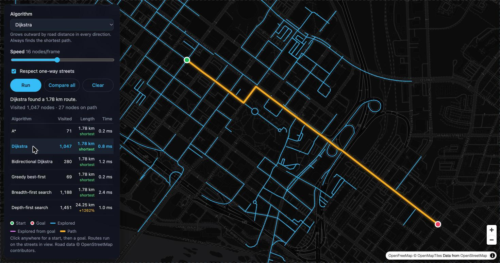

# Map Pathfinder

Watch search algorithms race across real road networks.

**Live demo:** https://himeshahuja.github.io/map-pathfinder/



## How to use

- Click anywhere for a start, then click a goal. The route runs right away on the streets in view.
- **Jump to a place** to search any city or address.
- **Compare all** runs every algorithm and lists nodes visited, path length (with how far each is over the shortest), and compute time. Click a row to replay that algorithm.
- Toggle **Respect one-way streets** to search with or without real traffic direction, and switch between dark and light maps.

## Algorithms

| Algorithm | Optimal? | Idea |
| --- | --- | --- |
| A* | yes | Dijkstra guided by straight-line distance to the goal |
| Dijkstra | yes | Expands outward by road distance in every direction |
| Bidirectional Dijkstra | yes | Searches from both ends and stops where they meet |
| Greedy best-first | no | Always heads for whatever looks closest to the goal |
| Breadth-first search | no | Fewest road segments, ignores length |
| Depth-first search | no | Follows one road as far as it goes, then backtracks |

## How it works

- **Road data:** the basemap is [MapLibre](https://maplibre.org/) drawing [OpenFreeMap](https://openfreemap.org/) vector tiles (OpenMapTiles schema). The routing graph is built from the road geometry in the tiles already loaded on screen, so routing needs no separate download and works anywhere.
- **Graph:** tile vertices are merged by position (tiles share a global coordinate grid), and each segment becomes an edge weighted by its haversine length. The tiles' one-way flags set edge direction. Clicks snap to the largest connected component.
- **Algorithms** (`js/algorithms.js`) are generators that yield each node as it is settled, so the UI can animate any of them step by step.
- **Rendering:** everything is drawn on canvas layers over the map. Nodes are pre-projected to Web Mercator, so panning redraws thousands of segments without per-node map API calls.

No build step and no dependencies beyond MapLibre GL from a CDN. To run locally:

```sh
python3 -m http.server 8000
```

Map data © OpenStreetMap contributors.
